# Font Maker — Illustrated User Guide

Version 0.3.56 · For the nanpa-linja-n sitelen pona Font Maker · Works offline when included in the deployed site.

This is the **complete guide to the visible controls**. The screenshots are **schematic illustrations based on the current controls**, not photographs of a particular saved glyph. Purple indicates selected/editable controls; black indicates final glyph ink; pale grey indicates a reference or alignment guide.

<nav class="chapter-toc" aria-label="Guide chapters">
<strong>Chapters</strong>
<ol>
<li><a href="#overview">1. Getting started and finding your way around</a></li>
<li><a href="#drawing">2. Drawing tools and the canvas</a></li>
<li><a href="#grid">3. Visible grid, spacing and snapping</a></li>
<li><a href="#brush">4. Brush palette — stroke, smoothing and fill choices</a></li>
<li><a href="#editing">5. Edit palette — selections, transforms, history</a></li>
<li><a href="#paths">6. Paths palette — editable curves and joins</a></li>
<li><a href="#repair">7. Paths → Inspect &amp; repair outlines (advanced)</a></li>
<li><a href="#layers">8. Layers palette — independent drawings and live components</a></li>
<li><a href="#inspect">9. Inspect palette — grid, glyph data and the original outline</a></li>
<li><a href="#compounds">10. Compounds tab — combining source glyphs</a></li>
<li><a href="#preview">11. Preview — see the actual compiled font pair</a></li>
<li><a href="#typography">12. Metrics &amp; kerning — editing font spacing</a></li>
<li><a href="#export">13. Build &amp; export — names, validation and portable files</a></li>
<li><a href="#shortcuts">14. Handy gestures and troubleshooting</a></li>
</ol>
</nav>

<a id="faq"></a>
## Quick answers — FAQ

Start here for common problems. Each answer gives the **quick action first**, followed by a link to the illustrated instructions. The drawings show the actual meaning of the purple controls, not an invented extra tool.

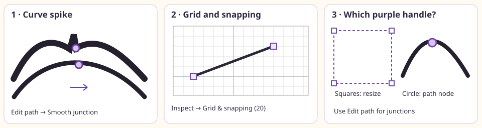

| I want to… / I see… | Quick answer | Illustrated details |
|---|---|---|
| **Remove a little spike where two curves meet** | Choose **⌁ Edit path**, click the *round purple junction*, then **Paths → Smooth junction**. Adjust the two small tangent handles if necessary. This is usually a kink, **not** a tiny backtracking spike. | [Curve join and spike walkthrough](#spike-between-curves) |
| **Select the join but keep getting a purple rectangle** | You're using **▣ Select**, which selects/resizes the entire shape. Switch to **⌁ Edit path** and select the actual interior junction. | [Recognise selection vs. path handles](#drawing) · [Paths](#paths) |
| **Join two lines or curves into one path** | Start the next Line/Curve at the highlighted open endpoint. For two existing paths, select their endpoints and choose **Join endpoints** or **Join smoothly**. | [Connect and edit paths](#paths) |
| **Draw a circle from its centre rather than a corner** | Normally drag from a corner; hold **Alt/Option** to start at the centre. On Linux, if Alt-drag moves your window, tick **Brush → Draw shapes from centre** instead. Hold **Shift** for a perfect circle (or square). | [Corner/centre shape diagram](#shape-gestures) · [Brush setting](#brush) |
| **Use the same brush width for the whole font** | Choose **Brush → Width** and **Smooth** once. They are remembered **per project**, including after switching glyphs or reopening the project. Existing drawings are not resized automatically. | [Brush defaults and what they affect](#brush) |
| **Make a straight line end square or flat** | Open **Brush → Line / Curve end caps** and choose **Flat** (ends exactly at the anchor) or **Square** (projects half a width past the anchor). Draw a new Line or Curve. | [Visual comparison of cap styles](#brush) |
| **Use a square Pencil or Eraser** | Open **Brush → Pencil / Eraser tip**, choose **Square**, then draw or erase. This changes the complete brush footprint, not merely the ends. | [Round versus square tips](#brush) |
| **Remember Brush options when switching glyphs or projects** | Brush settings belong to each project: set them once; the same values return on the next glyph, after reopening, or after exporting/importing the project JSON. | [Project-wide drawing preferences](#brush) |
| **Make the grid visible / change the cell size** | Tick **Grid** above the canvas. Open **Inspect → Grid & snapping** and enter a spacing, normally **20 editor units**. | [Grid diagram and settings](#grid) |
| **Make a line or anchor follow the grid** | Open **Inspect → Grid & snapping**, enable **Snap to grid**. You may hide grid lines while snapping. Freehand Pencil/Eraser deliberately do not snap. | [What snaps and what doesn't](#grid) |
| **Erase everything inside a selected area** | Use **▣ Select** or **◌ Lasso** to select the area, then choose **◫ Eraser** or press **E**. The selection stays active; **Undo** restores the ink. | [Selection and erasing](#editing) |
| **Erase the pale-grey original glyph** | The grey silhouette is a protected reference. Use **Inspect → Show original filled silhouette** to hide it; copy or restore the glyph if you need editable ink. | [Imported reference controls](#inspect) |
| **Fill a shape or cut a transparent hole** | **Fill** operates inside a bounded region. For a transparent vector hole, draw a closed inner Bézier contour and set its role to **Hole**, or use a **Cut** layer. | [Bézier paths](#paths) · [Layer types](#layers) |
| **Remove a detected tiny loop or crossing** | Open **Paths → Inspect & repair outlines**, run **Check outline**, select the reported issue and use the *matching* repair. Use **Undo** if the result is unsuitable. | [Repair diagram and cautions](#repair) |
| **Make a curved stroke smoother** | For a joined kink use **Smooth junction**. For bumpy freehand ink, adjust **Brush → Smooth** or select artwork and choose **Smooth outline**. | [Junction smoothing](#paths) · [Brush smoothing](#brush) |
| **Stop editing or moving the wrong layer** | Open **Layers**, click the layer you intend to edit, and check its **lock**, **eye**, and **export** switches. Keep a simple single layer until you need more. | [Layers illustration](#layers) |
| **Reuse a glyph and update copies automatically** | Open **Layers → Linked components (advanced)** and link to the source glyph. Transform the link independently without changing the source. | [Linked components](#layers) |
| **Preview my newly edited font** | In **Preview**, choose **Build preview fonts**; subsequent text changes reuse the built pair. Geometry changes may require rebuilding. | [Preview, test strings and geometry](#preview) |
| **Adjust cartouche spacing, rails or tallies** | In **Preview**, use the existing **Rails & spacing**, **Cartouche ends**, **Pi & long-pi**, **Tallies**, or **Alignment** tabs. Their settings apply when the font pair is rebuilt. | [Illustrated Preview settings](#preview) |
| **Adjust the width or kerning of a glyph** | Open **Metrics & kerning**. Select a glyph or pair and watch the live diagrams while changing the numbers. Click **Save spacing** or **Save pair**; **Build font proof** verifies the compiled TTF. | [Typography controls](#typography) |
| **Save work to another computer** | Use **Save project file** to preserve editable artwork. **Export fonts ZIP** is for installed TTFs; **Use on this site** only installs fonts in this browser. | [Projects and exports](#overview) · [Portable fonts](#export) |
| **Find why export is failing** | Open **Build & export → Font quality checks**, run **Check project**, follow any glyph links, then rerun the build. Compiler/test failures are not fixed by changing grid settings. | [Validation and build troubleshooting](#export) · [Troubleshooting](#shortcuts) |

**Where is the button?** **FAQ** is immediately before **ⓘ Help** in the drawing toolbar. Both open this local guide in a separate tab; **FAQ** jumps here, while **Help** starts at the overview. Each movable palette's **?** still opens its own detailed section.

---

<a id="overview"></a>
## 1. Getting started and finding your way around

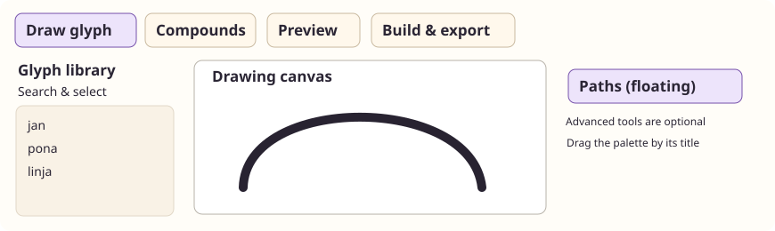

- **Draw glyph** is where you make and edit individual shapes. The glyph catalogue is on the left, the canvas is central, and optional floating palettes overlay it only while open.
- **Compounds** combines glyphs into an override without altering their sources.
- **Metrics & kerning** edits advance widths, left side bearings, glyph-pair spacing and optional kerning classes, with immediate schematic diagrams.
- **Preview** shapes test strings using the two compiled font faces and changes cartouche/long-*pi* geometry.
- **Build & export** gives the font its identity, validates it and exports the font pair.
- **FAQ** (immediately beside **Inspect**) opens quick solutions. **ⓘ Help** beside it opens this complete guide. The **?** in a floating palette jumps to its relevant illustrated section.

**Basic workflow:** select **jan** or another glyph from the left → choose **Pencil** → draw on white canvas → optionally edit with Select or Curve → open **Preview** and click **Build preview fonts** → use **Build & export → Export fonts ZIP**.

### Project and file buttons (at the top)

| Control | What it does | Important detail |
|---|---|---|
| Active project | Select another local project | The current editor saves to IndexedDB when available. |
| **+ New** | Create a separate editable project | Does not overwrite existing named projects. |
| **Delete project** | Remove the selected saved project | Confirm the destructive action. |
| **Open project** | Import a previously exported editable JSON project | Different from installing a compiled font ZIP. |
| **Import font** | Start a project using an existing TTF/OTF | You must provide and acknowledge the imported font's licence. |
| **Import ZIP** | Restore a compatible exported *editable* project/font ZIP | The verified ZIP carries its licence manifest. |
| **Save project file** | Download editable JSON | Use this for backups and moving editable work between computers. |

### Glyph library

**Find a glyph** searches name/aliases. **Glyph category** filters sitelen pona, printable ASCII, custom slots or special controls. **All / Drawn / Missing** filters by editing status. Click a glyph pill to work on that glyph; the thumbnail reflects saved editable artwork. The grey source guide is not your new drawing.

<a id="drawing"></a>
## 2. Drawing tools and the canvas

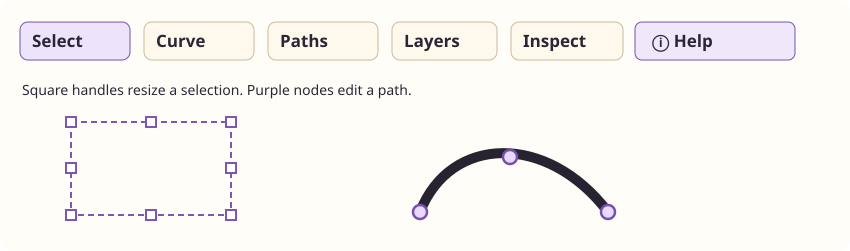

The toolbar uses short glyph icons to save canvas space. **Hover or focus a tool to read its full name.** The purple-highlighted icon indicates the active tool.

| Tool | Gesture / result | Good for |
|---|---|---|
| **▣ Select** | Click a vector object or drag empty space to marquee-select; resize with square handles | Moving, copying, scaling or erasing a chosen area |
| **◌ Lasso** | Trace an irregular boundary around artwork | Selecting part of a complex shape |
| **✎ Pencil** | Press and drag freehand | Rough drawing; smoothing is optional |
| **◫ Eraser** | Drag to erase; with a Select/Lasso region already active, choosing Eraser erases that region immediately | Removing editable ink, not the grey source guide |
| **╱ Line** | Drag a straight segment; begin on a highlighted endpoint to continue a path | Straight edges and connected outlines |
| **◯ Circle** | Drag from a corner for an ellipse; **Shift** makes a circle; **Alt/Option** draws outward from the centre | Rounded shapes and holes |
| **▢ Rectangle** | Drag from a corner; **Shift** makes a square; **Alt/Option** draws outward from the centre | Block forms |
| **⌒ Curve** | Drag endpoints, then drag or click the purple bend control; can start at an existing endpoint | Rounded strokes, arches and joining paths |
| **▰ Fill** | Click a bounded region, or select an area first and choose Fill | Filling closed editable regions |
| **⌁ Edit path** | Click anchors, drag tangent handles, add Bézier nodes and edit contours | Precise outline correction |
| **✥ Pan** | Drag to move the view without drawing; Space+drag also pans | Navigating a zoomed canvas |

**Zoom:** mouse wheel (over canvas), **+**, **−**, and **Fit** in the canvas header. Zoom and pan change only the view, never the stored outline. **Metrics** shows the font baseline and, for special slots, joining-rail guides. **Original glyph reference** in Inspect controls the pale grey source silhouette.

<a id="shape-gestures"></a>
### Circle and Rectangle: drag from a corner or from the centre

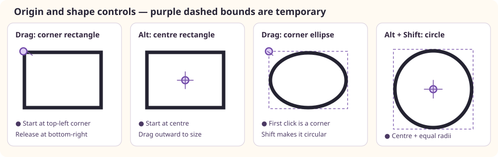

By default, the **first click is one corner** of the shape's bounding box. Drag to its opposite corner. While dragging, a **thin purple dashed box** shows the bounds; that guide disappears when you release the pointer and is **not exported** into the font. For the Circle tool, unequal width/height makes an ellipse; for Rectangle, an ordinary rectangle.

| Gesture | Circle tool | Rectangle tool |
|---|---|---|
| **Drag** | Ellipse, first point at a corner | Rectangle, first point at a corner |
| **Shift + drag** | Perfect circle | Square |
| **Alt/Option + drag** | Ellipse, first point at its **centre** | Rectangle, first point at its **centre** |
| **Shift + Alt/Option + drag** | Circle from the centre | Square from the centre |

**Linux alternative:** Some Linux window managers move the whole window when you Alt-drag. Open **Brush → Draw shapes from centre** (checkbox) to use centre-origin drawing *without* Alt. With that box checked, Alt/Option temporarily switches **back** to corner-origin drawing. The last saved preference is restored whenever you reopen the project. **Alt/Option on Mac is the ⌥ Option key.** The centre-origin option affects only new Circle/Rectangle shapes; it never repositions existing ones.

> **Tip:** Use **Shift** to maintain equal width and height; use **Snap to grid** independently for consistent anchor placement. Only Pencil, Eraser and Lasso remain freehand.

### What the purple squares mean

Eight squares surrounding a *rectangle* are **selection resize handles**. A small purple *circle* at the bend or junction of an existing path is an **editable node**. These are different features. Select **Edit path** when you want to change an actual Bézier anchor rather than resize the whole shape.

<a id="grid"></a>
## 3. Visible grid, spacing and snapping

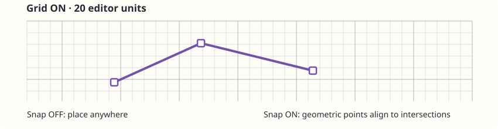

**The checked Grid box now draws real horizontal and vertical lines on the white artboard.** It no longer just changes the surrounding striped area.

| Setting | Location | Initial value | Effect |
|---|---|---|---|
| **Grid** | Drawing canvas header | On | Shows/hides pale grey grid lines behind editable ink and purple handles. |
| **Grid spacing (editor units)** | **Inspect → Grid & snapping** | **20** | Distance between adjacent grid lines in artboard drawing coordinates. Choose 5–100 in steps of 5. |
| **Snap to grid** | **Inspect → Grid & snapping** | **Off** | Snaps new Line/Curve/Rectangle/Circle points, new Bézier anchors and dragged editable anchors to nearest grid intersections. |
| **Metrics** | Drawing canvas header | On | Shows the baseline and relevant cartouche/long-pi joining guides; independent of the grid. |

Every **fifth line is slightly darker**, so with 20-unit spacing the stronger lines occur every 100 units. Increasing spacing makes fewer, larger cells. Decreasing spacing makes a finer grid. The grid moves and scales together with the artboard under zoom/pan.

**Independent controls:** Grid OFF + Snap ON is allowed, as is Grid ON + Snap OFF. The cursor and existing shape *hit testing* remain free-positioned so nearby anchor handles still work. Pencil, Eraser, Lasso, Select and Pan are never grid-snapped. Bézier **tangent handles and bend controls remain free**, so you can adjust curvature smoothly between grid points. Grid settings are remembered in this browser and are **not included in exported glyphs or TTFs**.

**Try this:** choose 20 units → enable Snap → draw a Line from near one grid intersection to another. It starts and ends exactly on the nearest intersections. Disable Snap to draw unconstrained curves again.

<a id="brush"></a>
## 4. Brush palette — stroke, smoothing and fill choices

Open the floating **Brush** palette from its toolbar button. Move it by dragging its heading; **× Hide** closes it without shrinking the canvas; **?** opens this section.

| Setting | What to expect |
|---|---|
| **Width** | Default **9** editor units, saved for the **current project** and reused across glyphs and sessions. Controls Pencil, Eraser, Line, connected strokes and outlined shapes. Changing Width while artwork is selected can also resize that selection. |
| **Smooth** | Default **55%**, saved per project. Sets Pencil smoothing (0–100%); increasing it removes more hand jitter without changing previously drawn glyphs. |
| **Smooth outline** | Processes existing editable artwork; if Select/Lasso is active, targets only that region and protects its border. Undo reverses it. |
| **Auto-straighten / circle** | Recognises suitable freehand Pencil strokes and replaces them with editable geometric shapes. |
| **Solid shape** | When checked, new Circle/Rectangle shapes are filled rather than just outlined. |
| **Draw shapes from centre** | Off by default: drag from a corner. Check to make Circle and Rectangle start at their centre (Linux-friendly alternative to Alt/Option-drag). Alt/Option temporarily toggles the choice. |
| **Line / Curve end caps** | **Round** by default. **Flat** terminates the outline at the endpoint; **Square** adds half the stroke width beyond it. Saved on each new editable Line/Curve path, so changing the control later will not restyle previously drawn strokes. |
| **Pencil / Eraser tip** | **Round** by default. Choose **Square** for a square-shaped stamp swept along the whole freehand stroke. This applies to the raster drawing and the editable vector eraser footprint. |

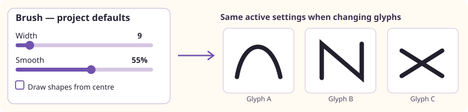

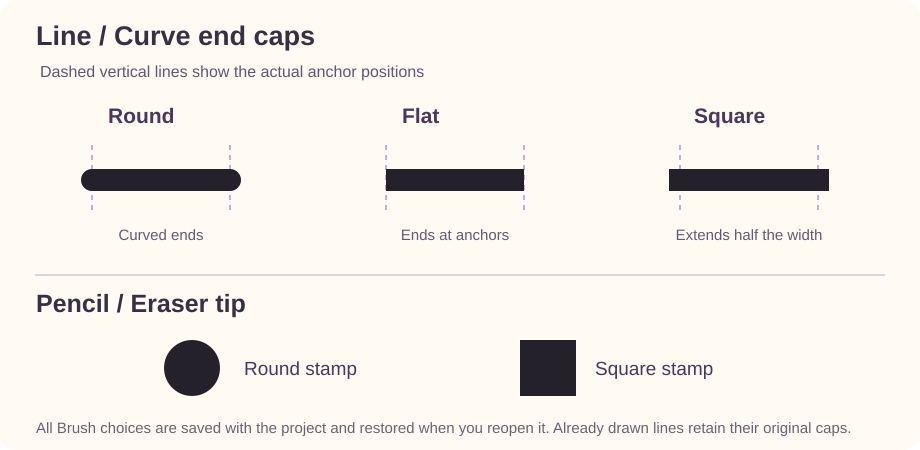

**Consistency across the font:** The current **Width**, **Smooth**, **Auto-straighten**, **Solid shape**, **Draw shapes from centre**, **Line / Curve end caps** and **Pencil / Eraser tip** belong to the *project*, not to a particular glyph. Set them once, switch to another glyph and keep drawing at the same width. They are autosaved with the project and included when you export/import its editable JSON. Switching to a *different project* restores that project's own preferences. Existing strokes and contours keep the geometry they were drawn with; a global width or cap preference change is not a destructive restyling command. **Smooth outline** is a command that edits selected artwork, not a persistent Brush option. A Line/Curve that you extend keeps its original cap style for that connected path.

A useful sequence is **Pencil → Smooth** at a moderate value → select an uneven area → **Smooth outline**. Avoid repeatedly smoothing already-clean shapes because each pass can soften useful corners.

<a id="editing"></a>
## 5. Edit palette — selections, transforms, history


Use **Select** for a rectangular marquee or to click an individual vector object; use **Lasso** for a freehand region. Drag inside the selection to move, or drag its perimeter squares to resize. Corner handles preserve proportions unless Shift is held; side handles adjust one dimension.

| Control | Action |
|---|---|
| **Select all** | Select editable artwork on the current layer. |
| **Copy / Cut / Paste** | Move reusable artwork between glyphs/projects; Cut also removes it from the source selection. |
| **Duplicate** | Add a copy without leaving the current glyph. |
| **Rotate left/right 90°** | Rotate the selected artwork by a quarter-turn. |
| **Rotate ° / Apply rotation** | Enter a custom angle, then apply. |
| **Scale % / Apply scale** | Set a scale percentage and apply it to selection. |
| **Flip H / Flip V** | Mirror selected artwork horizontally/vertically. |
| **Crop** | Retain only the selected area in editable raster art without changing glyph metrics. |
| **Delete** | Remove selected artwork. |
| **Deselect** | Clear selection handles and return to ordinary drawing. |
| **Copy glyph / Paste into glyph / Replace glyph** | Work with an entire glyph; Replace asks before overwriting. |
| **Undo / Redo** | Reverse/restore editable actions, including selected erasing and successful repairs. |
| **Clear glyph** | Removes the current active editable drawing after confirmation. |

**Selected Eraser and Fill:** first draw a Select/Lasso region. Click Eraser to clear *inside that region*, or Fill to add ink there. The selection stays active so you can adjust or Undo. The imported grey silhouette is only a guide and is not erased. Locked layers cannot be edited.

<a id="paths"></a>
## 6. Paths palette — editable curves and joins

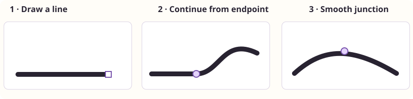

A line and a curve can share a node and become one editable path. Start a new Line or Curve close to a highlighted *open endpoint* to extend that path. Switch between Line and Curve without losing the connection.

**Recognising path controls:** square nodes at open ends can extend a path; circular nodes at an interior junction can be selected, dragged and smoothed; small tangent handles change the angle/curvature of Bézier segments. A purple bend handle changes a Curve tool's arc without moving its endpoints.

| Control | What to do |
|---|---|
| **Join endpoints** | Select one endpoint using Edit path, Shift-click another, then use Join endpoints. |
| **Join smoothly** | Connect the endpoints and align the curve direction. |
| **Smooth junction** | Select an interior node and align incoming/outgoing tangents to remove a kink. |
| **Close path** | Join first/last points of one open path into a closed contour. |
| **Close outline / Close hole** | Finish a Bézier contour as solid ink or transparent cutout. |
| **Cancel contour** | Discard the unfinished Bézier contour. |
| **Outline picker / Selected contour** | Select a finished path, then choose Filled (black) or Hole (transparent). |
| **Preview filled glyph** | Hide editing nodes and inspect the black silhouette. |

Inside **Edit nodes** (collapsed): advanced insertion/deletion/splitting, point type adjustment and extrema generation. Inside **Combine shapes** (collapsed): Union, Subtract, Intersect, Exclude. These operate on editable closed vector outlines; Undo restores the originals. Advanced operations do **not** need to be open for everyday drawing.

<a id="spike-between-curves"></a>
### How to fix a spike in a curve

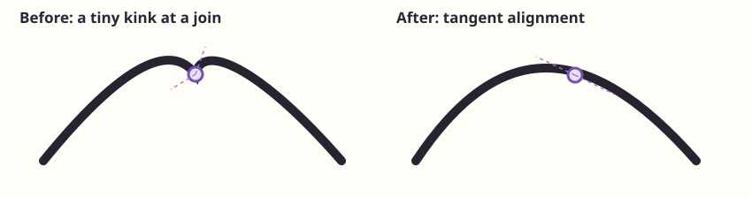

1. Select **Edit path (⌁)**, not Select (▣).
2. Click the curve and then click the **purple interior junction** where two sections meet.
3. In Paths, use **Smooth junction** (near the top of that palette).
4. If the curve still needs adjusting, drag its smaller tangent handles individually.
5. Use **Undo** if the modification is not right.

**Why not begin with “Trim tiny spike”?** That command removes a short *backtracking segment in an outline*. A kink between joined curves is normally a tangent alignment problem, and smoothing the junction is preferable because it keeps the path intact.

<a id="repair"></a>
## 7. Paths → Inspect & repair outlines (advanced)

This panel is **closed by default**. These commands are for geometry problems; they do not repair ordinary freehand inaccuracies and are not required to export every glyph.

| Button | Purpose and caution |
|---|---|
| **Check outline** | Scan for duplicates, intersecting contours, tiny spikes, small Bézier loops and invalid holes. Does not change artwork. |
| **Safe cleanup** | Conservative cleanup of duplicate/zero-length points and winding where safe. |
| **Trim tiny spike** | Remove a short backtracking vector spike. Not for an ordinary tangent kink. |
| **Trim tiny Bézier loop…** | Remove a small detected loop on a curve after selecting the reported issue. |
| **Remove overlaps…** | Resolve overlaps using vector boolean processing; confirm the change. |
| **Resolve crossing…** | Attempt to regularise a self-crossing outline; inspect result and Undo if needed. |

Use **Check outline → click the finding → choose the matching repair**. Repair reports are not proof of perfectly valid font geometry; the Build & export quality checks provide another gate. Edits affect the active editable layer, and risky operations require explicit confirmation.

<a id="layers"></a>
## 8. Layers palette — independent drawings and live components

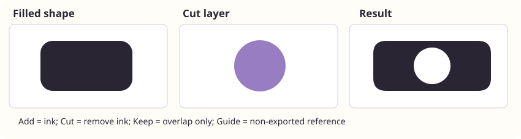

Open **Layers** for your current glyph. The list includes editable layers and a protected imported/Fairfax reference base. Click a layer to edit it. Double-click its label to rename. Reorder layers to change composition; eye controls visibility, lock prevents editing, and the export checkbox controls whether geometry contributes to TTF output.

| Layer type | Meaning | Example |
|---|---|---|
| **Add** | Add this layer's solid geometry | Main body of `jan` |
| **Cut (Subtract)** | Remove this layer's shape from the accumulated shape | A transparent centre/hole |
| **Keep (Intersect)** | Retain only shared filled areas | Clip a fill within another outline |
| **Guide** | Show reference artwork in the editor but not in export | Sketch or construction guide |

**+ Layer / Duplicate / Delete** manage editable layers. **Linked components (advanced)** lets a layer refer to another glyph's live outline, with independent position/scale/rotation. Changes to the source glyph can flow into dependent glyphs. Circular links are rejected. **Clipping & shape modifiers (advanced)** includes reversible layer composition, live boolean operands and clip boundaries. **Isolate layer** hides other editable layers for your view only; it does not change font export.

**Good habit:** keep the simple draw-on-one-layer workflow until a second layer genuinely helps. Complex layer effects are optional; they do not change Pencil/Curve tools.

<a id="inspect"></a>
## 9. Inspect palette — grid, glyph data and the original outline

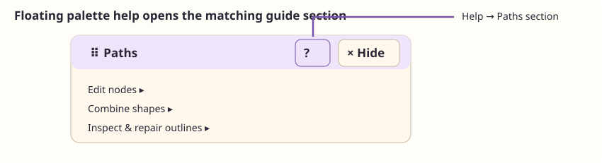

At the top of **Inspect**, **Grid & snapping** is a small collapsed section. It contains **Grid spacing** (default 20 editor units) and **Snap to grid** (off by default). The visibility checkbox itself stays in the drawing canvas header. See the [illustrated grid explanation](#grid).

The remaining Inspector sections are:

| Control | Meaning |
|---|---|
| **Word / slot name** | Identifies current glyph (from the fixed catalogue). |
| **Unicode assignment** | Shows the fixed Unicode/UCSUR value; read-only. |
| **Additional input aliases** | Alternative text names for this glyph. Click **Apply metadata** to save. |
| **Vector trace** | Preview of bitmap traced into SVG. |
| **Opacity threshold** | Determines which pixels count as solid in tracing. |
| **Outline simplification** | Controls path simplification of the traced raster outline. |
| **Export this glyph as SVG** | Download this individual glyph's vector output. |
| **Show original filled silhouette** | Show/hide non-editable grey source art. |
| **Reference opacity** | Set grey guide transparency (independent of glyph ink). |
| **Joining-stroke alignment** | For special cartouche/long-pi slots only, inspect/confirm attachment geometry. |
| **Restore selected glyph from font** | Recover imported source art into the editable glyph. |

The **grey source silhouette**, **grid** and **Metrics baseline** are all separate visual layers, not font ink. Hiding them does not delete a glyph; using Eraser on the grey reference does not remove it.

<a id="compounds"></a>
## 10. Compounds tab — combining source glyphs

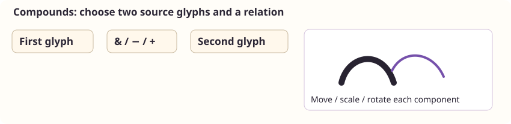

Choose **First glyph**, **Operator** and **Second glyph**. The operators are `&` (generic/font-defined compound), `−` (stacking) and `+` (nesting/scaling). Click **Create / edit override** to edit that specific combination. The two source glyphs are not overwritten.

In the preview, click a component and drag to move it. Set **Horizontal offset**, **Vertical offset**, **Scale** and **Rotation (degrees)** in the right-hand controls; **Reset component transform** restores its default placement. **Defined overrides** lets you revisit a saved compound; **Remove override** discards that combination's custom layout.

If a component is only an imported reference outline rather than editable geometry, follow the instruction in the Compounds panel to copy/draw its source first before export.

<a id="preview"></a>
## 11. Preview — see the actual compiled font pair

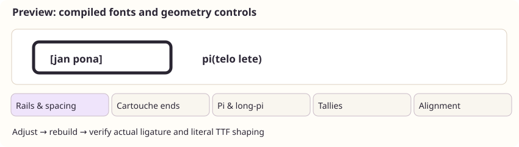

**Show font:** Both fonts, Ligatures only or Literal only. **Font size:** display size in pixels. **Build preview fonts:** compile the pair for preview. **Test text:** enter examples and compare the actual output.

Try:

```text
toki pona [jan pona]
["ABC"]
[nanpa½ :½ wan]
[jan,, telo,,]
pi(telo lete) pi jan
```

The **Ligatures** TTF shapes sitelen pona ligatures and native cartouche controls. The **Literal** TTF is for literal ASCII/quoted content. The Preview tab is a font-shaping test; it is not a substitute for a website's separate Toki Pona date/time parser.

### Rails & spacing

| Setting | What it changes |
|---|---|
| **Cartouche glyph spacing** | Extra spacing between adjacent cartouche glyphs. In this version its slider starts at zero; negative compression is **not** implemented. |
| **Top rail / Bottom rail** | Vertical placement of top and bottom cartouche rules. |
| **Rail thickness** | Shared horizontal rule stroke weight. |
| **Start/end padding** | Extra space at the left and right ends; minimum currently zero. |
| **Content X offset** | Shifts cartouche contents horizontally without shifting its rails. |

### Cartouche ends

**End shape** adjusts the cap curvature/height. **End curve Y** offsets the rounded curvature vertically. **Left cap stroke / Right cap stroke** control each cap independently. **Left X / Right X** adjust each cap horizontally. The cap-to-rail joins are maintained by the compiler.

### Pi & long-pi

**Pi height, Pi Y, Pi X** control long-*pi* start geometry. **Pi stroke** controls ordinary `pi`; **Long-pi stroke** separately controls extended `pi(...)`. **Round Pi tips** rounds eligible exposed tips while keeping attachment widths.

### Tallies

**Tally length**, **Tally Y**, and **Tally spacing** affect the small marks beneath cartouche glyphs. Use the preview strings containing `,,` to compare stroke placement before export.

### Alignment

**Fraction %** controls fractional glyph vertical alignment; **Baseline** and **Centre** provide quick presets. **Top padding / Bottom padding** reserve clearance outside rails and tallies to prevent font clipping. The clearance gauge visualises the reserved space.

Changes to font geometry cause the compiled preview pair to rebuild after a brief pause. If you are testing final output, confirm the last build completed before exporting.

<a id="typography"></a>
## 12. Metrics & kerning — editing font spacing

Open the **Metrics & kerning** tab beside **Draw glyph**, **Compounds** and **Preview**. This is an editing operation, not an export-only option. Select a glyph in the left-hand library, then open the tab to load that glyph's spacing settings; **Use selected glyph** also synchronises the choice.

**Live glyph metrics diagram:** Set **Advance width** (the horizontal progression to the next glyph) and **Left bearing** (clearance before the actual ink). The diagram updates immediately while you type; **Save spacing** persists the override, and **Use original** removes it. Blank input fields keep the native metric from the imported/template font. There is no independent editable right-bearing field because the right bearing depends on advance, left bearing and actual outline width.

**Live pair spacing diagram:** Choose **First glyph**, **Following glyph** and a signed **Adjustment**. Negative values bring the glyphs closer; positive values move them apart. The diagram changes immediately as you type, and **Save pair** records the adjustment. **Remove pair** clears it. **Kerning classes (advanced)** lets you define reusable classes; explicit pair adjustments override class rules.

**Cartouches and long-pi (Ligatures font):** Pair and class kerning also applies to corresponding contextual content glyphs in `[...]` cartouches and `pi(...)` long-pi constructions. Negative kerning uses GPOS positioning. **Positive kerning builds real connecting rail geometry** to cover the extra width: for adjacent content (such as `[aa]` or `pi(aa)`) a contextual content variant receives an extended rail; with one Fairfax space separator (such as `[a a]` or `pi(a a)`) the separator is substituted with a rail-bearing spacer. Repeated pairs inside longer constructions are handled. Unlike spacing-only adjustments, this preserves continuous cartouche top/bottom rails and long-pi lower strokes. Individual pair rules and kerning classes use the same mechanism. The compiler supports up to 128 distinct positive pairs with contextual variants per export; excess rules produce an explicit export error instead of a broken font. Structural end caps, unboxed glyph outlines and the Literal font's ASCII behaviour remain separate. The live diagrams remain schematic; use **Build font proof** to inspect the actual shaped output.

**Fractions and kerning:** When the **second** glyph has a fractional suffix, kerning changes only the space before it: neither the fraction itself nor its scaling is altered. The connector adapts to each supported vulgar suffix (`¼`, `⅓`, `½`, `⅔`, `¾`) and the equivalent ASCII suffixes (`1/4`, `1/3`, `1/2`, `2/3`, `3/4`) in both adjacent and space-separated cartouches and long-pi. The compiler matches the actual GSUB fractional variants, including ASCII fractions that expand into multiple shaping glyphs. The live diagram remains schematic; **Build font proof** shows the authoritative shaped result. Fractional suffixes on the *first* glyph, tally combinations and other complex intermediary sequences are not covered by this contextual connector guarantee and should be independently verified.

**Diagram limitation:** The drawings are intentionally schematic, not measured glyph outlines. A blank advance or bearing is shown using a labelled example value because the browser-side controls do not read the native horizontal metrics directly from the source TTF. The pair diagram likewise illustrates the spacing shift, not a fully shaped font run. These immediate diagrams are **not** confirmation of final font geometry, ligatures or GPOS behaviour. Click **Build font proof** after saving changes to compile the actual Rust/WASM-generated TTF and inspect its OpenType positioning. Structural spacing/cartouche slots remain protected.

<a id="export"></a>
## 13. Build & export — names, validation and portable files

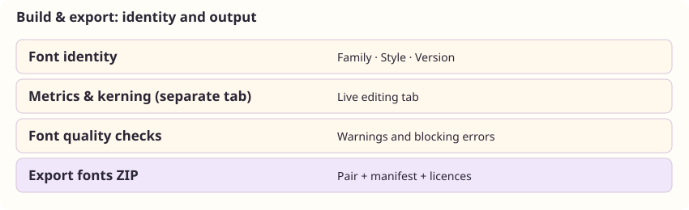

### Font identity

**Font family**, **Style**, **Version** and **PostScript base name** are written to the OpenType name table. **User project ID** identifies the portable project and is distinct from the browser's private IndexedDB key. Click **Save font identity** after changing names.

### Editable files and font ZIPs

| Button | Result |
|---|---|
| **Export editable project JSON** | Project backup with editable outlines/settings for future work. |
| **Export vector SVG assets ZIP** | Individual vector glyph assets. |
| **Export custom-name Unicode manifest** | Custom name/codepoint mapping for compatible website parsers. |
| **Export fonts ZIP** | Compiles both TTFs and packages a verified manifest, licences and quality report. |
| **Use on this site** | Saves the compiled font pair in this browser for other pages of this website. |
| **Import font ZIP** | Installs a previously exported compiled pair in this browser. |

**Advanced font settings → Rasterization profile** can select Default, Grayscale without grid-fitting, or Grayscale with grid-fitting. This affects generated-font display hints; it does **not** toggle the visible drawing grid.

### Font quality checks (optional)

Click **Check project** to inspect outline and dependency findings. Problems are reported with glyph references; inspection does not alter drawings. Compilation also checks the output TTF structures and browser font loading. The ZIP includes `quality-report.json` describing the checks performed. External Rust, fontTools, HarfBuzz and LibreOffice checks are additional release gates; a browser's quality report is not a blanket certification.

<a id="shortcuts"></a>
## 14. Handy gestures and troubleshooting

| Gesture | Effect / reminder |
|---|---|
| **Space + drag** | Pan without modifying the glyph. |
| **Wheel** | Zoom around the pointer. |
| **F** | Fit whole canvas. |
| **Drag Circle/Rectangle from a corner** | Default: the first point is a bounding-box corner; the last point is the opposite corner. |
| **Shift while drawing Circle/Rectangle** | Keep equal width and height: perfect circle or square. |
| **Alt/Option-drag Circle/Rectangle** | Start from the centre. On Linux enable **Brush → Draw shapes from centre** instead if Alt-drag is intercepted. |
| **Shift+Alt/Option Circle/Rectangle** | Perfect circle or square, drawn outward from its centre. |
| **Brush Width/Smooth across glyphs** | Saved per project and reused across glyphs; the drawn geometry itself is unchanged. |
| **Alt-drag line/curve endpoint** | Move an existing endpoint. |
| **Click purple interior junction** | Select it for repositioning and tangent editing. |
| **Double-click Bézier segment in Edit path** | Insert an editable node on the segment. |
| **Enter / Shift+Enter (Bézier draft)** | Close filled contour / close hole. |
| **Esc (Bézier draft)** | Cancel unfinished contour. |
| **Ctrl+Z / Ctrl+Y** | Undo/Redo; may ask before travelling to another glyph. |
| **Drag palette heading** | Reposition floating palette. Arrow keys when focused also nudge it. |
| **Double-click palette heading** | Reset palette position. |
| **? in palette heading** | Open that palette's section in this guide. |

**Alt-drag moves my Linux window:** tick **Brush → Draw shapes from centre**, then drag normally; hold Shift if you want a circle/square. [Shape gestures](#shape-gestures).

**My brush width resets when changing projects:** settings are per project, not global across every project. Set Brush → Width once in the new project. [Brush defaults](#brush).

**I see only white, no grid:** confirm **Grid** at the top of Drawing canvas is checked; it draws on the *artboard*, not the striped area outside it. In Inspect → Grid & snapping, try 20-unit spacing.

**My Pencil is not snapping:** intentional. Pencil is freehand even with Snap enabled. Use Line/Curve/Bézier/Circle/Rectangle for grid-aligned construction.

**I can't erase the grey outline:** it is a protected reference, not editable ink. Inspect → Show original filled silhouette toggles it off.

**Small spike at joined curve:** choose **Edit path**, select the purple interior junction and **Smooth junction**; do not start with contour cleanup unless Check outline reports a genuine tiny backtracking spike.

**The reference or guides appear in preview:** check the drawing and editing layers; grey source, artboard grid and metrics do not enter TTF output.

**Changing a glyph didn't change a linked copy:** inspect linked-component references, source layer export participation and circular-link warnings; build a new preview after modifications.

**Build fails or a font doesn't render:** use Font quality checks and then run the project's `./bin/test-all.sh` on a computer with Rust/WASM toolchain and external font-testing dependencies. JavaScript-only success does not certify the final TTF.

---

*This guide is shipped as Markdown (`FONT_MAKER_USER_GUIDE.md`), a browsable HTML copy (`guide.html`), and local SVG examples. It requires no network connection or hosted fonts. Help links lead to stable headings in this document.*
